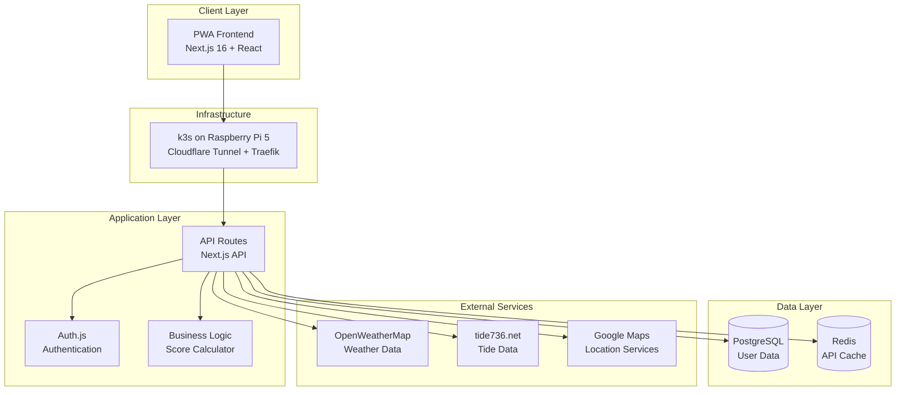
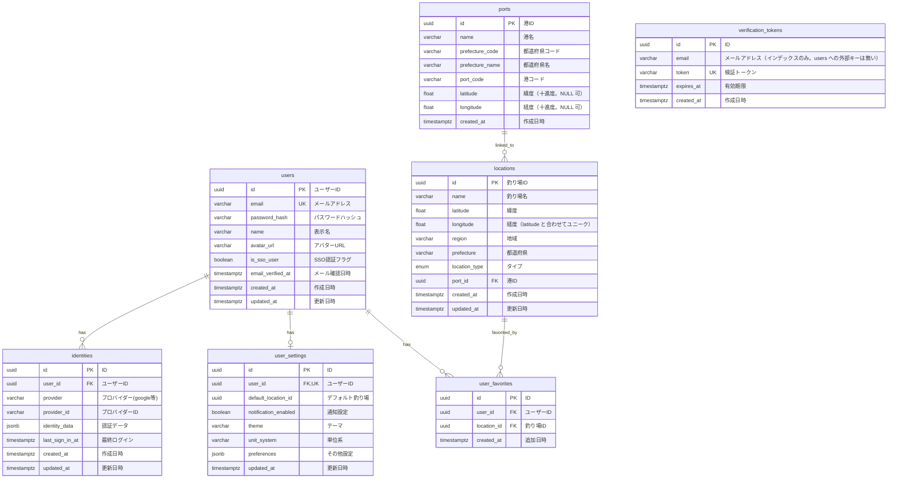
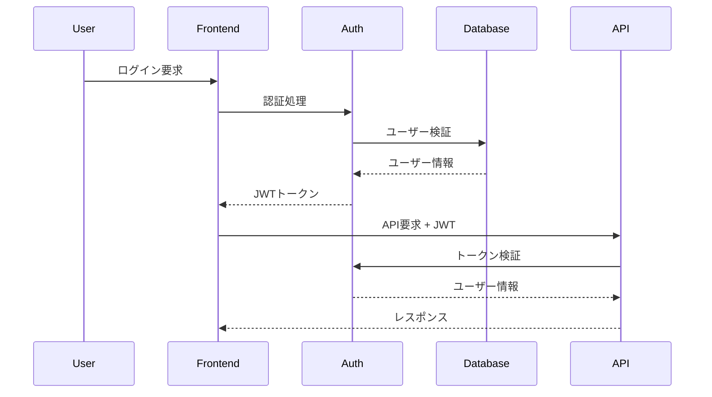

# 🏗️ システムアーキテクチャ

> - **状態**: 説明（参考）
> - **対応する実装**: `src/` 全体
> - **最終確認**: 2026-11-20（#388 で、読んで実装と突き合わせて直した。実行はしていない）

## システム全体構成



---

## 技術スタック

### Phase 1: MVP (Next.js フルスタック)

| レイヤー       | 技術                         | バージョン                | 理由                                     |
| -------------- | ---------------------------- | ------------------------- | ---------------------------------------- |
| フロントエンド | Next.js + React + TypeScript | 16.4.6 + 19.3.1 + 6.0.3   | SSR/SSG対応、PWA化、型安全性             |
| バックエンド   | Next.js API Routes           | 16.4.6                    | 迅速な開発、フルスタック統合             |
| スタイリング   | Tailwind CSS + shadcn/ui     | 4.3.5 + -                 | モバイルファースト、コンポーネント再利用 |
| 状態管理       | React の state・hooks・Context | -                       | 画面ごとの状態は hooks に閉じる。Zustand は使っていない（依存は #409 で削除）。React Query は入っていない |
| 認証           | Auth.js                      | 5.0.0-beta.32             | 多様な認証プロバイダー対応               |
| データベース   | PostgreSQL (Neon)            | 17                        | マネージドクラウド、Prisma ORM（7.10.1） |
| キャッシュ     | Redis (k3s Pod)              | 7.x                       | 外部API結果のキャッシュ、レート制限      |
| デプロイ       | Raspberry Pi 5 + k3s         | -                         | Cloudflare Tunnel + Traefik、arm64本番   |
| CI             | GitHub Actions               | -                         | PR で型・Lint・ビルド・k8s マニフェストを検証 |
| CD             | GitHub Actions → GHCR        | -                         | `main` への push で `deploy.yml` が動く。linux/arm64 のイメージを作って GHCR へ push し、k3s に適用する |

> バージョンは `package-lock.json` の解決済みの版（2026-11-20）。`package.json` の範囲は `^` で、更新で動く。

> `k8s/` 配下のマニフェストは本番（k3s）一系統である。namespace・Redis・cloudflared は
> [`fishing-infra`](https://github.com/kazumadev619-dev/fishing-infra) が所有する。詳細は [`k8s/README.md`](../../k8s/README.md)。
> ローカル開発に Kubernetes は使わず、`docker compose` に一本化している。

### 将来の拡張性

Phase 1完了後、必要に応じて以下の技術移行を検討：

- バックエンド分離（Go + Gin）
- モバイルアプリ展開（React Native / Flutter）
- マイクロサービス化

---

## フロントエンドアーキテクチャ

### コンポーネント設計パターン（アトミックデザイン）

```
src/
├── app/                # Next.js App Router
│   ├── api/           # API Routes（後述）
│   ├── auth/          # メール確認まわりのページ
│   ├── login/ register/ dashboard/
│   ├── healthz/ readyz/  # ヘルスチェック
│   ├── layout.tsx     # ルートレイアウト
│   └── page.tsx       # `/`
├── components/
│   ├── atoms/         # 最小単位のコンポーネント
│   ├── molecules/     # アトムの組み合わせ（FishingLocationMap など）
│   ├── organisms/     # 複雑なUIブロック
│   ├── providers/     # auth-provider、favorites-provider（Context）
│   └── ui/            # shadcn/ui の部品
├── hooks/             # カスタムフック
├── lib/               # サービス・クライアント・ユーティリティ（後述）
├── auth/              # Auth.js の設定・プロバイダ・コールバック
├── types/ constants/ emails/
├── generated/         # Prisma クライアント（生成物）
└── proxy.ts           # アクセス制御
```

`templates/` は無い。レイアウトは `app/` の `layout.tsx` が担う。

### 状態管理

状態は React の state と hooks、Context で持つ。`stores/` は無く、Zustand は使っていない。React Query も入っていない。

```
src/
├── components/providers/
│   ├── auth-provider.tsx       # セッション（SessionProvider）
│   └── favorites-provider.tsx  # お気に入り
├── hooks/
│   ├── useDashboardFavorite.ts   # ダッシュボードのお気に入り操作
│   ├── useFavoritesFetch.ts      # お気に入りの取得
│   ├── useFavoritesOptimistic.ts # お気に入りの楽観的更新
│   ├── useLocationSearch.ts      # 場所検索
│   └── usePortsData.ts           # 港データ
```

---

## バックエンドアーキテクチャ

### API設計パターン（Route Handler + サービス関数）

```
src/
├── app/api/            # Next.js API Routes
│   ├── auth/          # Auth.js（[...nextauth]）とメール確認（verify-email）
│   ├── locations/     # 場所検索（search）
│   ├── conditions/    # 環境データ（tide）
│   ├── weather/       # 天気
│   ├── scores/        # 釣りやすさスコア
│   ├── ports/         # 港
│   ├── client-errors/ # ブラウザの例外の受け口（POST）
│   └── favorites/     # お気に入り
├── lib/
│   ├── openWeatherService.ts / tideService.ts / locationService.ts
│   ├── portMappingService.ts   # サービス関数（クラスではない）
│   ├── scoring/       # スコア計算（潮汐・天気・時間帯）
│   ├── api/           # 外部 API 用の HTTP クライアント（リトライ・タイムアウト）
│   ├── cache/         # Redis クライアントとキャッシュのヘルパー
│   ├── validators/    # 入力検証
│   ├── utils/         # 日付・スコアのランクなど
│   └── prisma.ts      # Prisma クライアント
```

`services/` ディレクトリと、`repositories/` のようなデータアクセス専用の層は無い。サービス関数が `src/lib/prisma.ts` の Prisma クライアントを直接呼ぶ（認証だけ `src/auth/utils/userRepository.ts` を使う）。

---

## データベース設計

### ER図（Entity Relationship Diagram）



### 各テーブルの詳細説明

#### **認証・ユーザー系**

##### **users** テーブル

- **用途**: ユーザーの基本情報と認証管理
- **使い方**: ログイン時の認証、プロフィール管理、ユーザー識別
- **重要カラム**:
  - `email`: ユニークキー、ログイン用メールアドレス
  - `password_hash`: bcryptでハッシュ化したパスワード（平文は保存しない）
  - `is_sso_user`: Google等のSSO認証を使用しているか判定

##### **identities** テーブル

- **用途**: OAuth連携情報（外部認証。いまは Google のみ）
- **使い方**:
  - 1つのユーザーに複数のOAuth連携を持てる作りだが、プロバイダは Google だけ（GitHub は使っていない）
  - `provider`: 'google'
  - `(provider, provider_id)` がユニーク
  - `identity_data`: プロバイダー固有の認証情報をJSON形式で保存

##### **verification_tokens** テーブル

- **用途**: メール検証トークン管理（セキュリティ強化）
- **使い方**:
  - 通常登録時：ユーザー作成後、検証メールを送信しトークンを発行
  - パスワードでログインしたとき：未確認で有効なトークンが無ければ、発行して送り直す
  - トークン有効期限：1時間（`expires_at`）
  - 検証完了後：トークンを削除し`users.email_verified_at`を更新
- **重要カラム**:
  - `id`: 主キー（UUID）。`users` への外部キーは無い
  - `token`: ユニーク。crypto.randomBytes(32)で生成した64文字のランダム文字列
  - `email`: 検証対象のメールアドレス（インデックスのみ。ユニークではない）
  - `expires_at`: トークン有効期限（1時間後）
- **セキュリティ対策**:
  - `allowDangerousEmailAccountLinking`を使用せず、メール検証で本人確認
  - 期限切れトークンは `signup` の中で削除される
  - 同一メールアドレスの古いトークンは新規発行時に削除

#### **釣り場・位置情報系**

##### **ports** テーブル

- **用途**: 港マスタデータ。**潮汐API連携に必須**
- **重要性**:
  - 潮汐API（tide736.net）は緯度経度ではなく「都道府県コード + 港コード」で検索
  - 釣り場の潮汐情報を取得するには、位置情報から対応する港を逆引きする必要がある
- **使い方の流れ**:
  ```
  釣り場の座標 (latitude, longitude)
    ↓
  最寄りの港を検索: ports.latitude/longitude で距離計算
    ↓
  ports.port_code を取得
    ↓
  Redisキャッシュで潮汐データを検索（src/lib/cache/）
  ```

##### **locations** テーブル

- **用途**: 釣り場マスタデータ
- **使い方**:
  - ユーザーが検索・選択する釣り場情報
  - `latitude`, `longitude` で天気API（OpenWeatherMap）を呼び出す
  - `port_id` で港と紐付けして潮汐データを取得
  - 複数の釣り場タイプ対応（岸釣り、港、河川等）

#### **ユーザー系**

##### **user_favorites** テーブル

- **用途**: ユーザーが☆をつけた「お気に入り釣り場」
- **使い方**:
  - ユーザーが釣り場をお気に入り登録 → テーブルにレコード挿入
  - ダッシュボード「お気に入り一覧」で表示
  - users ←→ locations の中間テーブル
  - 削除時：user_favorites のレコード削除 → locations はそのまま

##### **user_settings** テーブル

- **用途**: ユーザーの個人設定・プリファレンス
- **現状**: 列はあるが、アプリからは読み書きしていない（将来の設定用）。`theme` などを使う画面・処理は無い
- **特徴**: `user_id` はユニークキー（ユーザー1人に1件のみ）
- **使い方（想定）**: 以下は想定する中身で、実装にはまだ無い。
  ```json
  {
    "user_id": "uuid",
    "default_location_id": "uuid", // 初期表示釣り場
    "notification_enabled": true, // 釣り条件通知の有効/無効
    "theme": "system", // UI テーマ（既定は system）
    "unit_system": "metric", // 単位系（metric/imperial）
    "preferences": {
      "show_moon_phase": true, // 月の満ち欠け表示
      "wind_alert_threshold": 10, // 風速アラート閾値（m/s）
      "auto_refresh_interval": 300 // 自動更新間隔（秒）
    }
  }
  ```

---

### データフロー例：「釣り場Aの今の釣り条件スコアを表示」

```
1. ユーザーが釣り場Aを選択
   ↓
2. 天気データ取得（3 と並べて呼ぶ）
   - locations(A).latitude, longitude取得
   - Redisキャッシュ確認: [weather:…] で30分以内のデータ？
   - 有効 → 返す
   - 期限切れ → OpenWeatherMap API呼び出し → Redisにキャッシュ保存
   ↓
3. 潮汐データ取得（2 と並べて呼ぶ）
   - locations(A).port_id取得
   - ports(port_id).port_code, prefecture_code取得
   - Redisキャッシュ確認: [tide:…] で6時間以内のデータ？
   - 有効 → 返す
   - 期限切れ → tide736.net API呼び出し → Redisにキャッシュ保存
   ↓
4. スコア計算
   - scoring（src/lib/scoring/）: 天気 + 潮汐 + 時間 → 0-100のスコア算出
   ↓
5. UI表示
   - スコア、天気、潮汐情報をダッシュボードに表示
```

2 と 3 は互いに依存しないので、`/api/scores` は並べて呼ぶ。失敗したときの扱いは [api-error-handling.md の「`/api/scores` の上流の呼び出し」](./api-error-handling.md#apiscores-の上流の呼び出し)。

---

### キャッシュ戦略の重要ポイント

> **NOTE**: 天気・潮汐・場所・スコアのキャッシュは Redis で管理する（`src/lib/cache/`）。TTL は `src/lib/cache/config.ts`。

キーは `<プレフィックス>:` のあとに、パラメータを**キー名の昇順**で `名:値` とつないだもの（`generateCacheKey`）。

| 項目         | 天気                           | 潮汐                           | 場所検索              | スコア（`/api/scores`）        |
| ------------ | ------------------------------ | ------------------------------ | --------------------- | ------------------------------ |
| **キー**     | `weather:lang:ja:lat:<緯度>:lon:<経度>:units:metric`（座標は小数2桁に丸める）。予報（`/forecast`）は `weather:forecast:lang:ja:lat:<緯度>:lon:<経度>:units:metric` | `tide:day:<日>:month:<月>:port:<港>:prefecture:<県>:range:<範囲>:year:<年>` | `location:limit:<件数>:query:<日本に絞った検索語>` | `score:date:<日付>:lat:<緯度>:lon:<経度>:port:<港>:prefecture:<県>`（今日は `slot:HH:mm` が付く。座標は小数2桁） |
| **TTL**      | 30分                           | 6時間                          | 1時間                 | 30分                           |
| **実装**     | `src/lib/openWeatherService.ts` | `src/lib/tideService.ts`      | `src/lib/locationService.ts` | `src/app/api/scores/route.ts` |

同じ Pod の中で、同じキーの取得が進行中なら、あとから来た要求は新しく取りに行かず、その結果を待って共有する（`src/lib/cache/helpers.ts`、#442）。

---

### テーブル関連図（SQL JOIN例）

**釣り場Aの基本情報を取得:**

```sql
SELECT
  l.*,
  p.port_code,
  uf.created_at as favorited_at
FROM locations l
LEFT JOIN ports p ON l.port_id = p.id
LEFT JOIN user_favorites uf ON l.id = uf.location_id AND uf.user_id = ${userId}
WHERE l.id = ${locationId};
-- NOTE: 天気・潮汐データはRedisキャッシュから別途取得
```

### 釣り場タイプ（location_type）

| 値         | 説明                 |
| ---------- | -------------------- |
| `SHORE`    | 岸釣り（堤防・磯）   |
| `SURF`     | サーフ（砂浜）       |
| `PORT`     | 港・漁港             |
| `RIVER`    | 河川・河口           |
| `LAKE`     | 湖・池               |
| `OFFSHORE` | オフショア（船釣り） |
| `OTHER`    | その他               |

### テーブル概要

| カテゴリ         | テーブル              | 説明                                  |
| ---------------- | --------------------- | ------------------------------------- |
| **認証系**       | `users`               | ユーザー情報（認証+プロフィール統合） |
|                  | `identities`          | OAuth連携（Google等）                 |
|                  | `verification_tokens` | メール検証トークン（TTL: 1時間）      |
| **釣り場系**     | `locations`           | 釣り場マスタ                          |
|                  | `ports`               | 港マスタ（潮汐API用）                 |
| **ユーザー系**   | `user_favorites`      | お気に入り釣り場                      |
|                  | `user_settings`       | ユーザー設定                          |

> **NOTE**: 天気・潮汐キャッシュはPostgreSQLテーブルではなくRedisで管理（`src/lib/cache/`）

---

## キャッシュ戦略

### キャッシュの層

層は2つ。

- **アプリケーションキャッシュ（Redis）**: 上の表のとおり。外部 API の結果を保つ。レート制限のカウンタにも使う（`src/lib/rateLimit.ts`）。
- **ブラウザキャッシュ**: `Cache-Control` ヘッダで効かせる。`/api/scores` は `private, max-age=1800`（30分）、`/api/locations/search`・`/api/conditions/tide` は `private, max-age=3600`（Redis から返したとき。そうでなければ 300）。認証必須の API なので、`public` にして共有キャッシュに載せない。

Service Worker のキャッシュは無い。セッションは JWT の Cookie（Auth.js）で、Redis には持たない。

---

---

## セキュリティアーキテクチャ

### 認証・認可フロー



### メール検証によるセキュリティ強化

- **脅威**: `allowDangerousEmailAccountLinking: true`により、攻撃者が被害者のメールアドレスでGoogleアカウントを作成し、既存アカウントを乗っ取ることが可能だった
- **対策**: メール検証トークンシステムの実装
  - 通常登録時：ユーザー作成後、検証メールを送信（`users.email_verified_at`はnull）
  - Google ログイン時：メールの一致だけでは連携しない。確認済みのアカウントと一致すれば拒否（AccessDenied）し、未確認の行は削除して作り直す
  - 検証完了後：`users.email_verified_at`を更新する。リンクを開くだけでは確定せず、ボタンの POST で確定する
- **トークン管理**:
  - 64文字のランダム文字列（`crypto.randomBytes(32)`）
  - 有効期限1時間
  - 検証完了またはタイムアウト時に自動削除
- **実装ファイル**:
  - [src/lib/email.ts](../../src/lib/email.ts): Resend APIでメール送信
  - [src/lib/token.ts](../../src/lib/token.ts): トークン生成・検証・削除
  - [src/app/api/auth/verify-email/route.ts](../../src/app/api/auth/verify-email/route.ts): 検証エンドポイント
  - [src/auth/callbacks/signInCallback.ts](../../src/auth/callbacks/signInCallback.ts): signInコールバックで検証状態チェック
