# 🔐 認証システム フロー図・シーケンス図

> - **状態**: 説明（参考）
> - **対応する実装**: `src/auth/`
> - **最終確認**: 2026-11-20（#388 で、読んで実装と突き合わせて直した。実行はしていない）

このドキュメントでは、Fishing Conditions Appの認証システムのフロー図とシーケンス図を提供します。

---

## 📊 全体認証フロー図

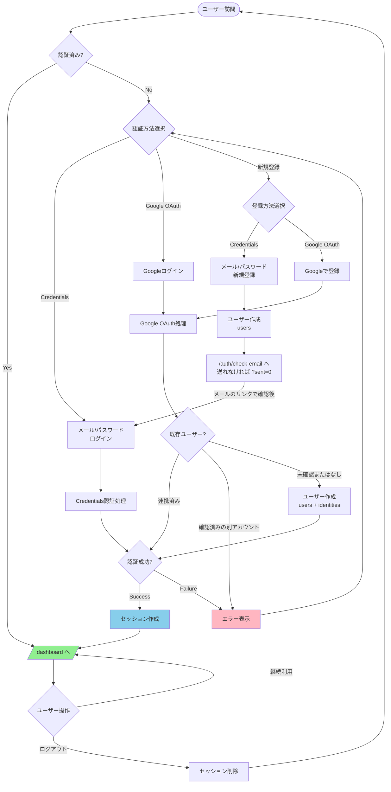

---

## 🔑 Credentials認証シーケンス図

### 新規登録フロー（メール検証付き）

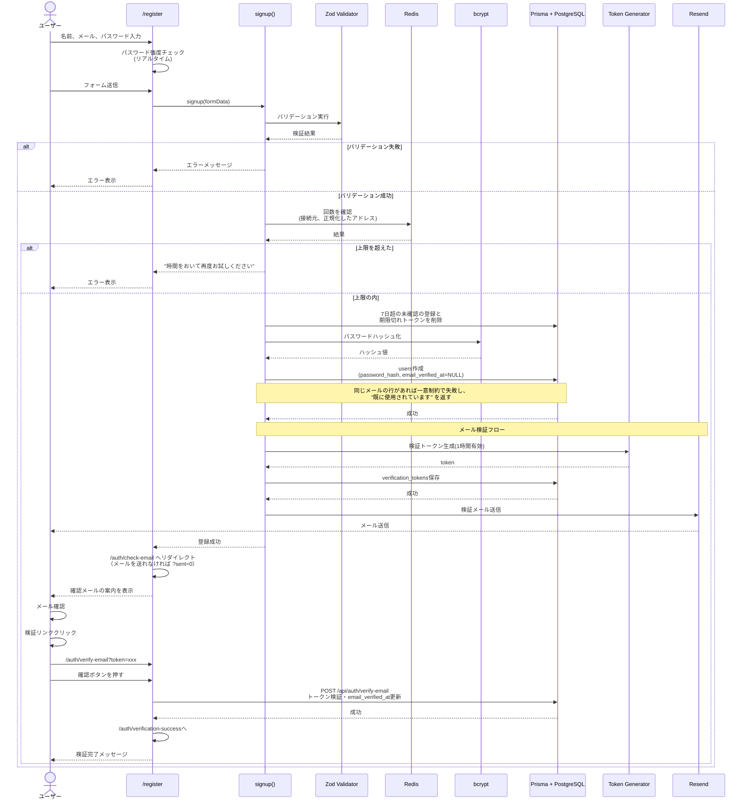

### ログインフロー

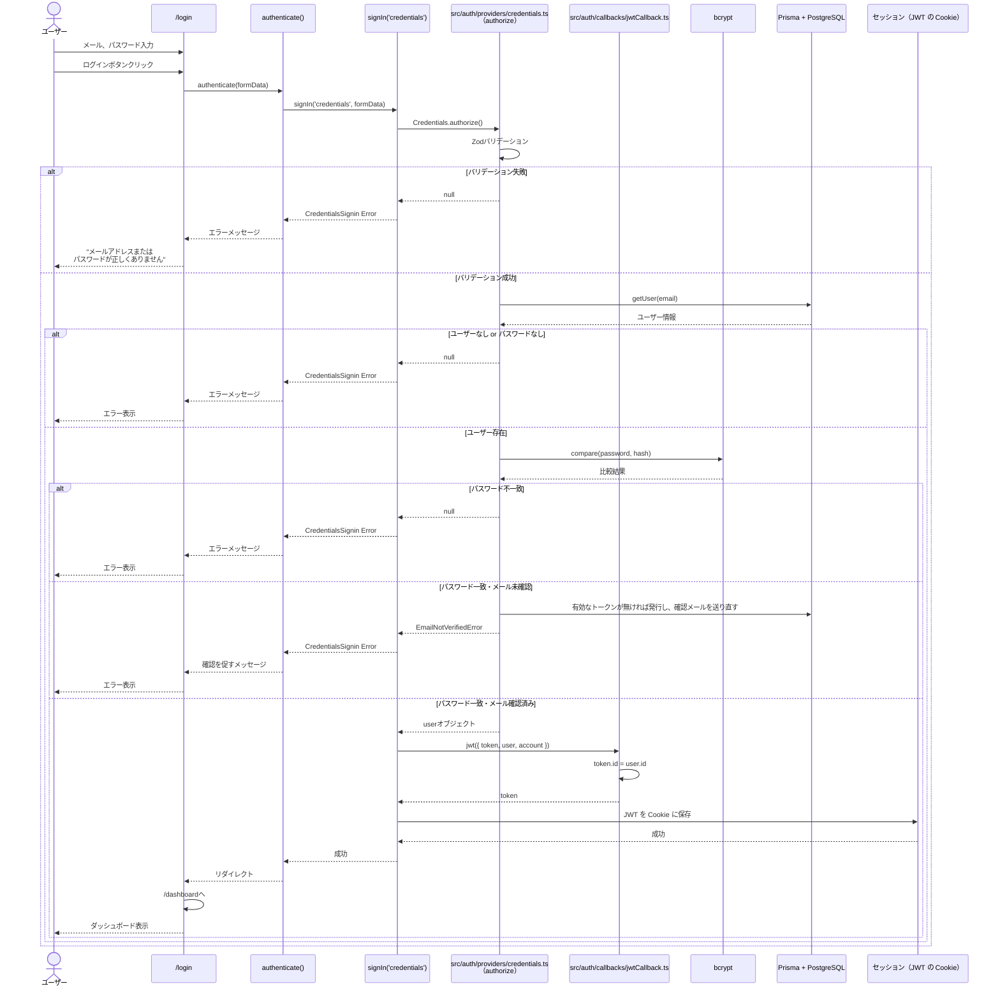

---

## 🌐 Google OAuth認証シーケンス図

### 新規ユーザー登録フロー

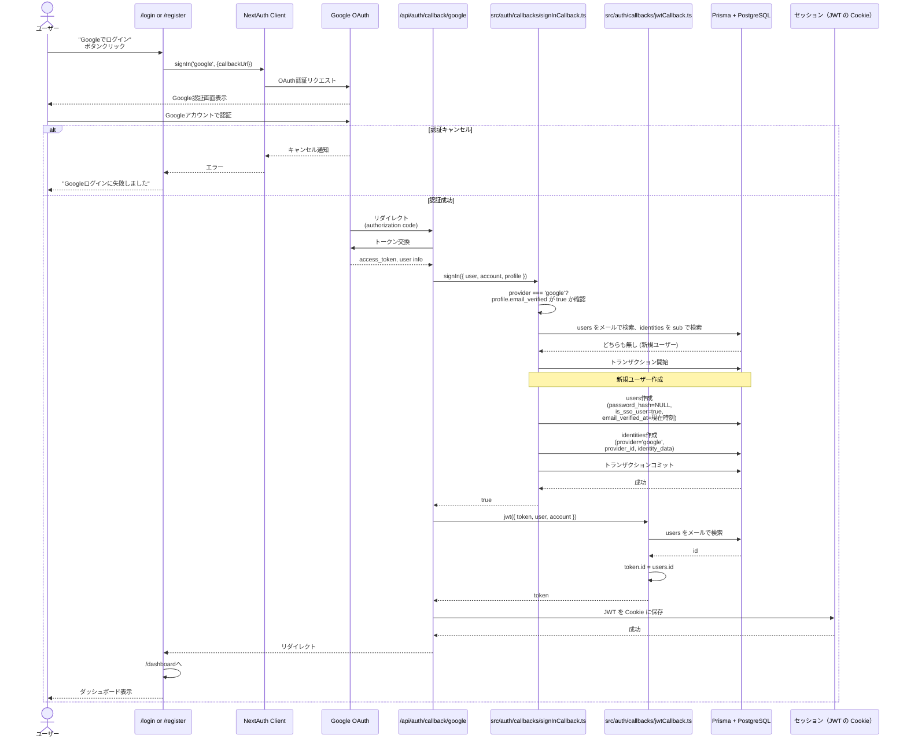

### 同じメールのアカウントがある場合の Google ログイン

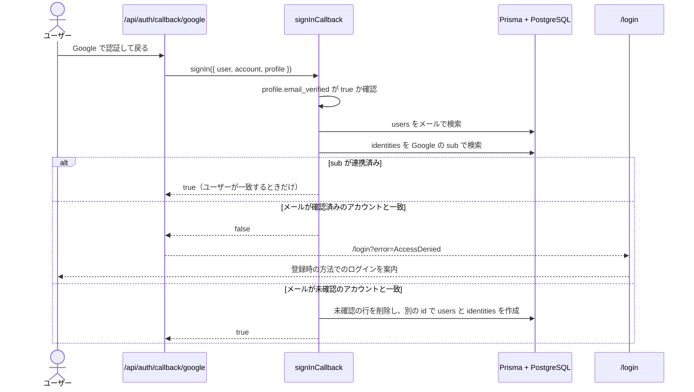

## 🔄 アカウント連携状態遷移図

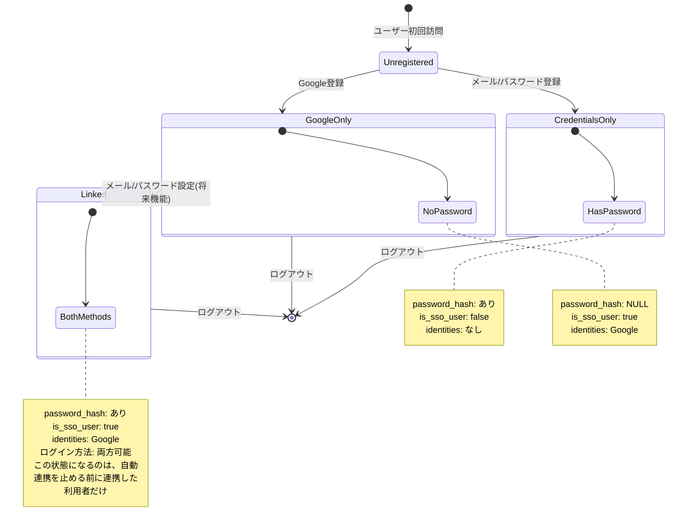

---

## 🗂️ データベーストランザクションフロー図

### 新規Google OAuth ユーザー作成

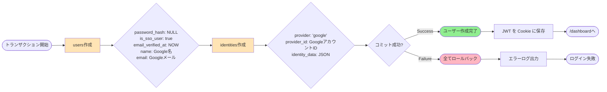

### 既存ユーザーの Google ログイン

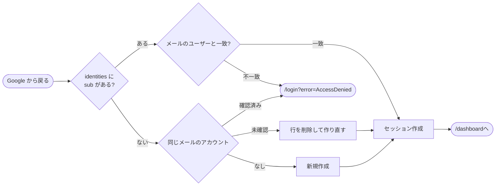

---

## 🔐 セッション管理フロー

セッション戦略は JWT（`src/auth/config.ts`）。`sessions` テーブルは無く、Redis にも持たない。セッションの実体は Cookie に入った JWT だけ。

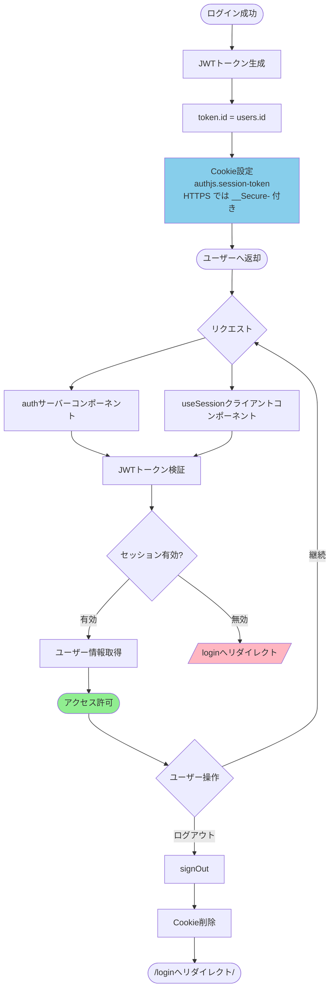

> Cookie 名は Auth.js v5 の既定（v4 の `next-auth.session-token` ではない）。HTTPS のときの `__Secure-` 付きの名前は `src/proxy.test.ts` が使っている。ブラウザで実際の名前を見る確認は、まだしていない。

---

## 🛡️ アクセス制御フロー（Proxy）

`src/proxy.ts`（Next.js 16 の Proxy）が `src/auth/edge.ts` の `authorized` を呼ぶ。**既定は拒否**で、公開するパスだけを列挙している。`/dashboard` だけを保護しているのではない。

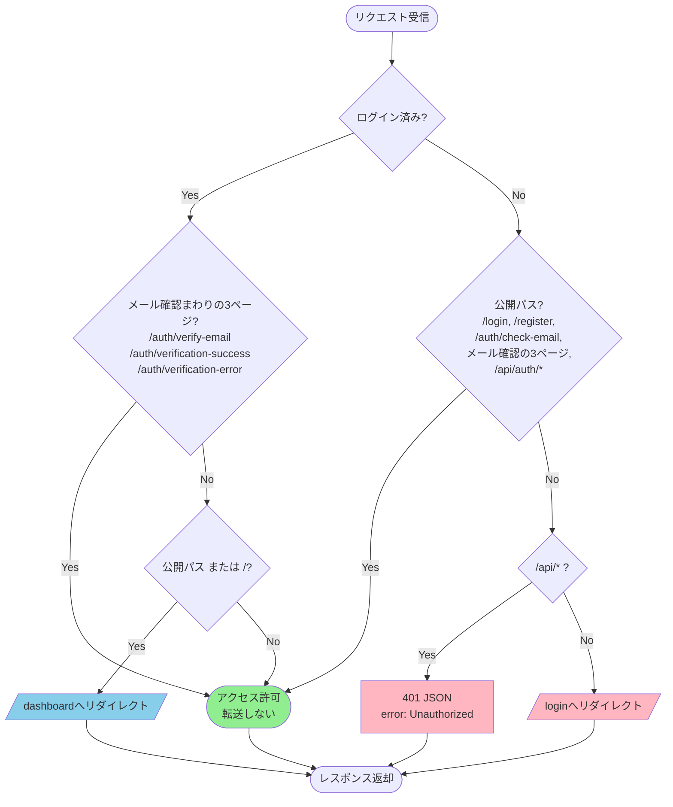

`/healthz`、`/readyz`、`/_next/*` などは `proxy.ts` の matcher で除外されるので、この判定に来ない。

---

## 📋 エラーハンドリングフロー

`authenticate()`（`src/lib/actions.ts`）が、ログインの失敗を利用者向けの文言にする。

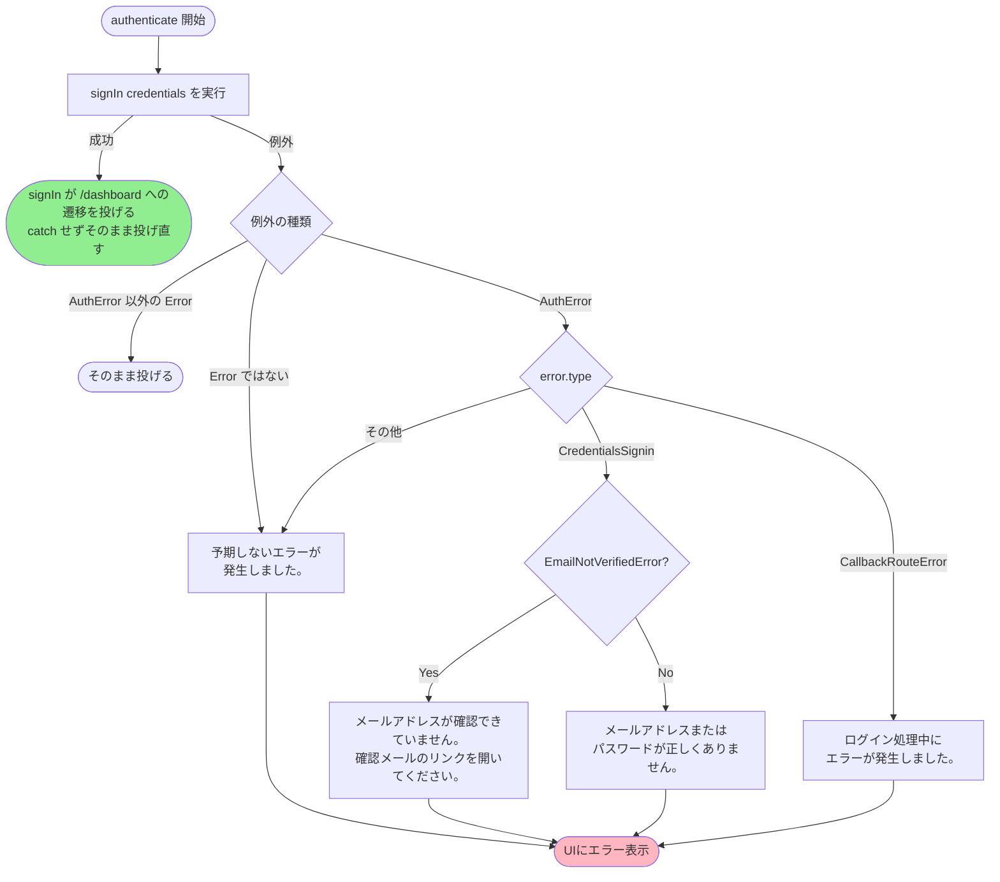

Google ログインの拒否は `authenticate()` を通らず、`/login?error=AccessDenied` に戻る。

---
